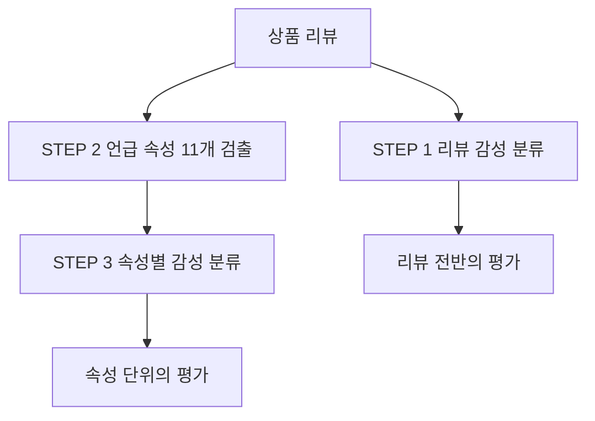
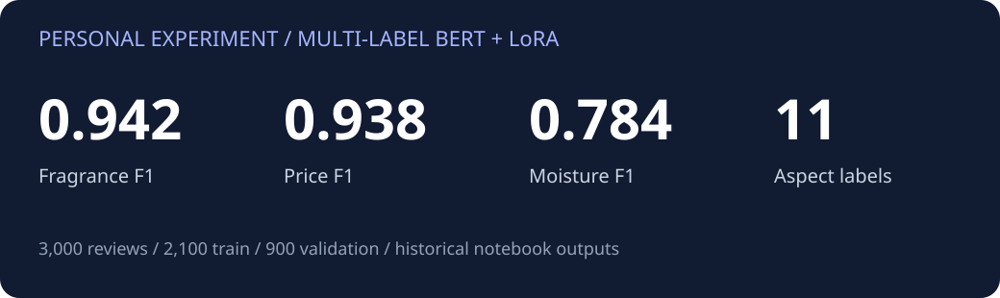

<div align="center">

# 리뷰의 속성을 읽는 NLP
### 상품 리뷰 감성 분석 · 11개 속성 검출 · BERT & LoRA

**KT AIVLE School 미니프로젝트 2차 | 김건우 개인 실습 & 팀 프로젝트**


**한 문장에 담긴 여러 속성을 데이터로 구조화하고, 속성별 결과까지 확인한 NLP 실험입니다.**

[개인 구현](notebooks/personal/02_multilabel_keunwoo.ipynb) · [실험 결과](results/personal_per_aspect.csv) · [수행 범위](docs/CONTRIBUTIONS.md)

</div>

## 어떤 문제를 풀었나요?

“보습은 좋지만 가격은 비싸요”처럼 하나의 리뷰에는 여러 속성과 서로 다른 감성이 함께 존재합니다. 리뷰 전체의 긍정·부정뿐 아니라 **어떤 속성이 언급됐는지**, **각 속성을 어떻게 평가했는지** 구분하는 것이 목표입니다.



## 제가 수행한 핵심 작업

개인 실습에서는 **STEP 2 다중 레이블 속성 검출**을 수행했습니다. 전처리부터 모델 입력 구성, 일반 학습·LoRA 실험, 속성별 평가까지 연결했습니다.

| 작업 | 구현 내용 | 드러나는 역량 |
|---|---|---|
| 리뷰 단위 데이터 구성 | 같은 text의 aspect를 중복 제거해 모으고 `MultiLabelBinarizer`로 multi-hot 변환 | 원본 구조를 모델의 입출력으로 변환 |
| 11개 속성 스키마 | 보습·기능·밀착·가격·향·편의성·기타·외형·포장·품질·피부 순서 고정 | 라벨과 출력 해석의 일관성 |
| 학습 입력 구성 | `float32` 라벨, 동적 패딩, 커스텀 collator | 데이터와 모델 사이 연결 구현 |
| 학습 방식 비교 | BERT 일반 파인튜닝과 LoRA 설정·실행 | 모델 적응 학습 실습 |
| 세부 결과 확인 | 속성별 precision·recall·F1·support 출력 및 시각화 | 결과를 속성 단위로 분석 |

**속성의 존재와 감성을 구분했습니다.** 가격에 부정적인 문장도 가격을 언급한 것이므로, 속성 검출에서는 가격 라벨이 1이 됩니다.

## 개인 실험 결과



| 지표 | 당시 저장 결과 |
|---|---:|
| 향 검출 F1 · LoRA | **0.942** |
| 가격 검출 F1 · LoRA | **0.938** |
| 보습 검출 F1 · LoRA | **0.784** |
| 검증 리뷰 | **900개** |
| 일반 / LoRA 학습 시간 | **911.5초 / 531.5초** |

개인 실험은 리뷰 3,000개를 7:3으로 분리했습니다. 위 F1은 **속성 존재 검출** 결과입니다. 학습 시간은 학습률 등 설정이 다른 두 실행의 저장값이며, [설정표](docs/EXPERIMENTS.md)와 [전체 11속성 결과](results/personal_per_aspect.csv)를 함께 제공합니다.

## 팀 프로젝트의 전체 흐름

| 단계 | 모델·방법 | 코드 |
|---|---|---|
| STEP 1 · 리뷰 감성 | BERT 일반 학습·LoRA | [리뷰 감성 노트북](notebooks/team/01_review_sentiment.ipynb) |
| STEP 2 · 속성 검출 | BERT 다중 레이블 분류 | [속성 검출 노트북](notebooks/team/02_aspect_detection.ipynb) |
| STEP 3 · 속성별 감성 | BERT·RoBERTa, 리뷰와 속성을 함께 입력 | [속성 감성 노트북](notebooks/team/03_aspect_sentiment.ipynb) |

팀 코드는 전체 실습 맥락을, 개인 코드는 제가 수행한 다중 레이블 실험을 보여줍니다.

## 코드 살펴보기

```python
grouped_data = data.groupby("text")["aspect"].apply(lambda x: list(set(x)))
mlb = MultiLabelBinarizer(classes=labels)
encoded_labels = mlb.fit_transform(grouped_data)
```

같은 리뷰의 속성들을 하나로 모아 고정된 11개 출력에 맞춥니다. 이후 BERT의 `multi_label_classification`과 sigmoid 임계값을 사용해 여러 속성을 동시에 예측합니다.

```text
notebooks/personal/  김건우 개인 실습
notebooks/team/      팀의 3단계 실습
results/             당시 개인 평가값과 실험 설정
docs/                수행 범위와 실험 기록
data/                입력 스키마와 합성 예문
```

## 실행 환경

```bash
pip install -r requirements.txt
jupyter notebook
```

교육용 원본 `data.csv`를 `data/`에 넣고 노트북을 실행합니다. 다른 위치라면 `DATA_PATH`로 지정하세요. GPU 환경을 권장하며, 노트북의 설치·한글 폰트 셀은 Colab/Linux 환경을 기준으로 작성됐습니다. 데이터 스키마는 [입력 안내](data/README.md)를 참고하세요.

## 이 프로젝트에서 보여드릴 수 있는 것

- **데이터를 모델 입력까지 연결하는 구현:** 행 단위 리뷰를 multi-hot과 tensor로 구성
- **다중 레이블 문제의 이해:** 속성 존재와 긍정·부정의 구별, 11개 출력 해석
- **실험 결과를 확인하는 습관:** 평균 지표와 함께 속성별 precision·recall·F1·support 확인
- **다양한 모델 학습 경험:** BERT·RoBERTa 실습 흐름과 LoRA 적응 학습

교육 과정의 제공 골격을 바탕으로 수행한 프로젝트입니다. 개인 수행 범위와 팀 작업은 [기여 문서](docs/CONTRIBUTIONS.md)에서 구분했습니다.
